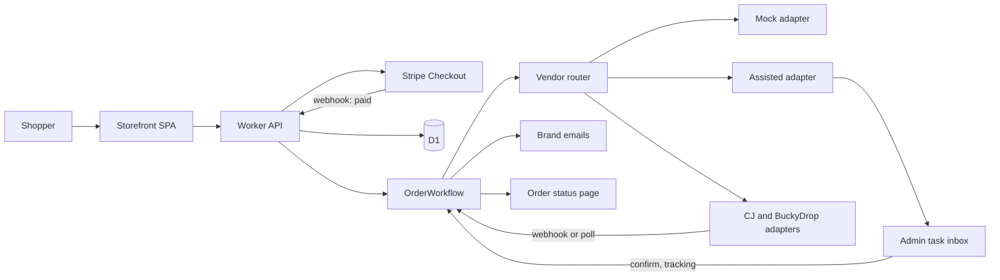
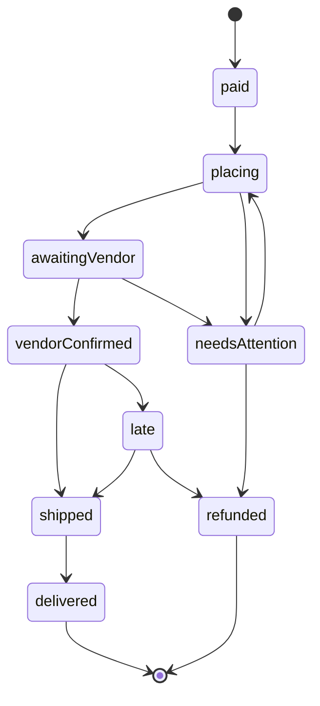

<!-- Canonical build plan for the storefront relay. Generated from the approved Cursor plan on 2026-10-26. Adaptations for the repo: Section 4 spells out the full relay protocol, links are repo-relative, the user is named instead of "you", and Slice 5 cross-references the FTC notes in BUSINESS_NOTES.md. Change only with user approval; record every change in .docs/handoff.md and, for contract clauses, under Amendments in .docs/GOAL.md. -->

# Curated Dropship Storefront: Build Relay Plan

## 0. Decisions and execution model

This plan is approved. Implementation starts with Slice 0 when the user pastes the Slice 0 kickoff prompt (Section 4) into a fresh chat.

- **Stack (chosen):** custom build on Cloudflare plus Stripe.
  - React 19 + MUI 9 storefront and back office.
  - One Cloudflare Worker that serves static assets and runs the Hono API, Workflows, and cron jobs.
  - D1 database, R2 media storage, Stripe-hosted Checkout.
- **Anonymity (chosen):** the repo stays public and holds only made-up demo brands.
  - The real brand name, logo, domain, products, suppliers, costs, and customers live only in Cloudflare (D1, R2, secrets) and a gitignored `private/` folder.
  - Deploys run from the owner's machine. GitHub CI only builds and tests.
  - Remaining risk: someone could still match the live site's JavaScript to this repo through code search. Only a private repo removes that.
- **Defaults to confirm during review:**
  - US-only launch.
  - Launch categories are 14+ desk accessories and science gadgets.
  - Children's products (ages 12 and under) need a CPC on file before they can go live.
  - Nothing containing seeds, soil, or plant material.
- **Process:** the same sequential relay the owner used for the automation-pitch project.
  - One slice per fresh chat; each slice commits `feat(slice-NN): ...`; the user reviews after the relay.
  - Contract files: `.docs/GOAL.md`, `.docs/BUILD_PLAN.md`, `.docs/handoff.md`, plus `.docs/BUSINESS_NOTES.md`.
  - The rules `storefront-relay.mdc` and `public-repo-hygiene.mdc` are scoped to this repo, not `alwaysApply`. The owner's multi-root workspace also contains automation-pitch, whose always-on rules (relay, Mantine, Tabler, workflow serialization, visual-improvement log) appear in every chat. They do not apply here. The kickoff prompt says so and tells agents to read both rules.
- No tracked file names the real brand or domain. That includes this plan.

### Baseline facts (verified 2026-10-26)

- Branch `main` has one commit, `f2daa49` (`Initial commit`, README only). A GitHub remote `origin` exists; the relay never pushes.
- `README.md` is modified (it embeds the order-flow diagram) and uncommitted.
- Untracked files that Slice 0 commits:
  - `.docs/image.png`: the order-flow diagram (customer, store, vendor contact method, ship from China).
  - `.docs/direct-dropship.excalidraw`: the diagram's editable source, copied in during planning.
  - `.docs/middleman-amazon-warehouse.excalidraw`: an earlier, unrelated warehouse business diagram, kept as background for the US-stock idea.
  - `.github/workflows/render-excalidraw.yml`: renders `.excalidraw` files to SVG on push and commits them.
  - The contract files, both rules, `.gitignore`, and `.gitattributes`.
- `private/` exists locally and is gitignored. It is never committed.
- The Cursor editor host is Windows and its file tools can save files with CRLF endings. `.gitattributes` (`* text=auto eol=lf`) keeps LF in the repo.
- No application code, `package.json`, or tests exist yet. Node 24.21.0 and npm 11.19.0 are installed. Wrangler and the Stripe CLI are not installed globally; Slice 1 adds Wrangler as a dev dependency.

## 1. Business reality check

Researched October 2026. Sources, the unit-economics worksheet, the vendor comparison, and the non-code launch checklist are in `.docs/BUSINESS_NOTES.md`.

- **Every parcel now pays duty.**
  - The US $800 de minimis exemption is suspended for all countries.
  - China-origin goods pay normal duty, the older China Section 301 tariffs, and a new 12.5% Section 301 tariff in force since July 24, 2026. The IEEPA tariffs were struck down in February 2026.
  - From January 20, 2027, postal shipments subject to these duties need electronic Entry Type 13 filing.
  - Use DDP (duties-paid) shipping lines so customers never get a bill at the door, and build the duty into the price.
- **The EU is expensive to start.**
  - Since July 1, 2026, every parcel under €150 pays a €3 duty per item type, and the seller pays it.
  - An EU handling fee is expected from about November 2026.
  - VAT needs IOSS registration, and the GPSR product-safety rules require an EU responsible person.
  - Launch US-only.
- **Kids' toys are the riskiest category.**
  - Since July 8, 2026, toys, children's products, and battery-powered products need CPSC certificate data filed at import, with no low-value exemption.
  - Products for ages 12 and under also need third-party lab testing and the store's own Children's Product Certificate (CPC).
- **Gardening kits:** seeds, soil, and plant material from China face USDA import restrictions. Sell tools and planters, and source seeds in the US.
- **Knockoffs:** many Taobao and RedNote finds copy designer toys or licensed characters. Stripe, Meta, and the law all punish this. List generic products and shoot original photos.
- **WeChat cannot be safely automated.**
  - Tencent forbids bots on WeChat accounts (personal and WeCom staff), and those accounts get banned. The only official automation, WeCom Customer Service, handles inbound support only.
  - WeChat vendors therefore stay human-in-the-loop.
  - Better: ask them to ship through an agent with an API, such as CJdropshipping or BuckyDrop. BuckyDrop buys from Taobao and 1688 on the store's behalf, consolidates samples, runs quality checks, does neutral or branded packaging, and ships DDP.
- **Payments.**
  - Stripe allows dropshipping, but it may hold reserves or delay payouts for new accounts.
  - Long shipping times drive chargebacks, which are the main threat to the account.
  - Stripe does not offer PayPal to US businesses.
  - The business pays vendors immediately but Stripe pays out days later, so keep working capital on hand.
- **Thin unit economics (illustrative numbers).**
  - Landed cost: $6 product + $1 agent fee + about $10 DDP shipping + $0.50 insert ≈ $17.50.
  - At a $39.99 price, Stripe fees (about $1.46) and a 4% refund reserve (about $1.60) leave about $19 before ads. Break-even return on ad spend (ROAS) is about 2.1.
  - Cold Meta traffic for a new brand often costs $15–35 per purchase.
  - Bundles, free-shipping thresholds, and repeat buyers matter more than any single product.
- **Shipping speed and the law.**
  - DDP lines from China take about 7–15 days.
  - The FTC Mail Order Rule requires shipping within the stated time (30 days if none is stated), and offering a cancel option when late. The order workflow sends that notice automatically.
- **Brand integrity:** parcels must not arrive with Chinese invoices or another seller's branding. Require neutral or branded packaging from every vendor.
- **Growth path:** once a product proves itself, bring a small batch into a US third-party warehouse (3PL) for 2–5 day delivery. Most China sellers moved to this after de minimis ended, and it overlaps with the warehouse idea already in `.docs/middleman-amazon-warehouse.excalidraw`.
- **Ads.**
  - Meta Advantage+ already generates ad text, backgrounds, and variations, and can run fully automated campaigns from a store URL.
  - Its API creates AI-generated ads in a paused state so they can be previewed first.
  - Start there with original product photos, and build a custom creative kit after the store works.
- **Trend tools** show products that are already saturated. The curated brand and the samples-first quality bar are the real differentiators.

## 2. Architecture



### Stack and approved libraries

- **Tooling:** Node 24 + npm, one package with no monorepo, Vite with `@cloudflare/vite-plugin`, TypeScript.
- **Client:** React 19, MUI 9 (`@mui/material`, `@mui/icons-material`, Emotion), React Router 7, TanStack Query, Zustand for the cart, Fontsource fonts.
- **Worker:**
  - Hono, with its typed RPC client used by the storefront.
  - Drizzle ORM over D1, with SQL migrations.
  - R2 (`MEDIA` binding), Workflows (`ORDER_WORKFLOW` binding), cron triggers, HTMLRewriter.
  - The `stripe` SDK, using its fetch client and SubtleCrypto webhook verification.
  - Cloudflare Email Sending (public beta; included with Workers Paid) behind an `EmailSender` interface, with React Email templates. Resend is the fallback.
  - Turnstile and Workers rate limiting.
- **Back office:** react-admin 5.15+ (supports MUI 9), as a separate Vite entry served at `/admin`.
- **Shared:** Zod 4 schemas, `yaml` for scenario fixtures, money stored as integer cents.
- **Tests:**
  - Vitest, on the major version `@cloudflare/vitest-plugin` supports (4.1+ at planning time).
  - Three Vitest projects: client (jsdom + Testing Library), worker (runs inside workerd), and shared (Node).
  - MSW for vendor HTTP calls; Playwright + `@axe-core/playwright` for end-to-end tests.
- Any other runtime dependency needs the user's approval.
- **Why a SPA with edge-injected meta tags instead of server rendering:** traffic will come mostly from ads and social, and HTMLRewriter gives crawlers real titles, Open Graph tags, and JSON-LD product data. Server rendering can come later if organic search matters.

### Source layout

```text
src/client/storefront   src/client/admin   src/client/brand (theme factory, presets, sections)
src/worker/api  payments  orders  fulfillment/adapters  workflows  notify  seo  feeds
src/shared/schemas  orders (state machine)  pricing (margin)  compliance  money
src/db/schema.ts   migrations/
fixtures/brands  products  vendors  scenarios      scripts/      e2e/
private/  (gitignored: real brand packs, denylist, notes)
```

### Multi-brand model

- **A brand is data.**
  - `BrandConfig` (Zod) holds the name, hostnames, order prefix, layout preset, theme tokens (palette, fonts, corner radius), home sections, copy and policy markdown, checkout branding, markets, statement-descriptor suffix, and social links.
  - Brand assets live in R2.
- **Brand resolution.** The Worker looks up the brand by hostname (D1, cached) and inlines it into the HTML, so the page never flashes the wrong theme. Outside production, `?brand=` overrides the lookup.
- **Theming and layout.**
  - `createBrandTheme(brand)` builds an MUI theme with CSS variables.
  - Layout presets with generic names (`playful`, `clean`) pick component variants.
  - Home pages are lists of typed sections: hero, collection grid, product grid, story, trust badges, newsletter.
- **Shared catalog.** Product visibility is set per brand, so sub-brands share one catalog and one order pipeline.
- **Checkout branding.** Each Stripe Checkout session gets `branding_settings` (name, logo, colors, font, corners) from the brand, so one Stripe account serves every brand. Receipts still show the account-level business name.

### Order lifecycle



The `OrderWorkflow` runs these steps:

1. Route each line item to a vendor offer (primary, then fallback).
2. Call the adapter's `placeOrder`.
3. Wait for a `vendor-confirmed` event. A timeout creates an operator task.
4. Wait for a `shipped` event, timing out at the ship-by date. On timeout, send a late notice with a cancel link, then wait again.
5. Wait for a `delivered` event, up to 60 days.
6. Complete the order.

Every transition passes through the shared state machine and is appended to `order_events`.

### Vendor adapters

```ts
export interface VendorAdapter {
  readonly kind: 'mock' | 'assisted' | 'api' | 'web';
  placeOrder(req: PlaceOrderRequest): Promise<
    | { status: 'placed'; vendorOrderRef: string; costCents: number; currency: string }
    | { status: 'needs_operator'; task: OperatorTaskDraft }
    | { status: 'rejected'; reason: 'out_of_stock' | 'price_changed' | 'address_invalid' | 'other'; detail?: string }
  >;
  getStatus?(vendorOrderRef: string): Promise<VendorStatusUpdate>;
  cancel?(vendorOrderRef: string): Promise<void>;
  parseWebhook?(request: Request): Promise<VendorStatusUpdate | null>;
}
```

- **`mock`:** replays YAML scenarios: happy path, out of stock, price increase, vendor goes silent, partial shipment, lost parcel, customs hold, and late-then-cancelled.
- **`assisted`:** for vendors reached by WeChat, WhatsApp, email, or their own website.
  - It renders a bilingual (Chinese and English) order message and creates an operator task with copy buttons.
  - It resumes the workflow when the operator records the vendor reference and cost paid, and later the tracking number.
- **`cj`:** CJdropshipping API 2.0. Create the order without payment, pay from the account balance after approval, and fetch tracking.
- **`buckydrop`:** BuckyDrop OpenAPI. Taobao and 1688 sourcing, shop orders keyed by our fulfillment ID, and webhooks. BuckyDrop's shared sandbox is used for tests.
- **Later:**
  - A `web` runner: Playwright on the operator's machine fills in a vendor's website and stops before payment.
  - A `us-stock` adapter for orders fulfilled from a US 3PL.

### Seeing what an order does before it happens

- **Stripe:** test mode and Sandboxes. The Stripe CLI (`listen`, `trigger`) is for manual runs. Automated tests sign fixture events with the Stripe SDK's test-header helper.
- **Workflows:** `introspectWorkflow` in `@cloudflare/vitest-plugin` turns off sleeps and injects events, so a two-week order runs in seconds.
- **Vendors:** `MockAdapter` scenarios, plus MSW fixtures built from the CJ and BuckyDrop docs and BuckyDrop's sandbox.
- **Simulator:** `npm run simulate -- <scenario>` prints a timeline of payment, vendor messages, operator tasks, and customer emails. Generated `.docs/scenarios/*.md` files show the user every case in plain language.

### Anonymity mechanics

- **`wrangler.jsonc`:** a generic Worker name, no `routes`, `workers_dev: false`, `preview_urls: false`, and `keep_vars: true`. Custom domains are attached in the Cloudflare dashboard, and Wrangler leaves them alone when the config has no routes.
- **Secrets:** set with `wrangler secret put`, and kept locally in a gitignored `.dev.vars`.
- **Real brand pack:** lives in `private/brands/<slug>/` and is uploaded with `npm run brand:push -- <dir> --remote`, which uses Wrangler `d1 execute` and `r2 object put`.
- **Leak checks:** `npm run leak-check` and a pre-commit hook scan tracked and staged files against `private/denylist.txt`. In CI the file doesn't exist, so the check is skipped with a notice.
- **Everything public uses demo brands:** fixtures, screenshots, and evidence. No public source maps, and no repo URL or author string in the bundle.
- **Webhooks on a gated site:** while a site sits behind Cloudflare Access, `/api/webhooks/*` gets an Access bypass. Signature checks protect those routes.

## 3. Frozen goal

Mirrored verbatim in `.docs/GOAL.md`, which ends with an `## Amendments` section. Implementing agents never edit clauses. Handoff entries cite clause IDs.

### Product (P)

- **P-01** One deployment serves every brand. A brand is validated data plus assets, and adding one needs no code unless it needs a new layout preset.
- **P-02** Only made-up demo brands are ever tracked. No real brand name, domain, logo, product, supplier, cost, or customer data.
- **P-03** Mobile-first. Every storefront flow works at 360 px width and inside the Instagram and Facebook in-app browsers; desktop is checked at 1440 px.
- **P-04** MUI 9 is the only UI kit (react-admin for the back office). Storefront flows meet WCAG 2.2 AA, with clean axe runs.
- **P-05** Storefront initial JavaScript is at most 250 KB gzipped. The admin is a separate bundle.

### Brands and theming (BT)

- **BT-01** `BrandConfig` covers the fields listed in BUILD_PLAN Section 2 ("Multi-brand model") and is validated by Zod.
- **BT-02** The brand is resolved from the hostname and inlined at the edge, with no theme flash. `?brand=` works only outside production.
- **BT-03** At least two generically named layout presets exist. Home pages are composed from typed sections.
- **BT-04** Checkout branding, emails, meta and Open Graph tags, and the favicon all follow the active brand.
- **BT-05** Invalid brand data falls back to a neutral theme and logs an error; it never breaks the site.

### Catalog and compliance (CT)

- **CT-01** Products have variants, R2 images, collections, per-brand visibility, and a draft/live/retired status.
- **CT-02** Prices are integer cents plus a currency code. Only the server computes prices.
- **CT-03** Every product carries compliance data: age grade, batteries, magnets, small parts, plant/seed/soil content, CPSC-regulated flag, CPC file, HS code, and country of origin.
  - Publishing is blocked when any of that data is missing.
  - It is also blocked for a product for ages 12 and under without a CPC on file.
  - Anything containing seeds, soil, or plant material can never be published.
- **CT-04** Product pages show a delivery window computed from the product's shipping profile.
- **CT-05** Raw product and collection HTML contains the title, description, Open Graph and Twitter tags, and Product JSON-LD.

### Checkout and payments (CP)

- **CP-01** Checkout is Stripe-hosted only. Card data never touches our code.
- **CP-02** Sessions use per-brand `branding_settings`, allowed countries from the brand's markets (US at launch), shipping options, and promotion codes.
- **CP-03** Webhooks are signature-verified and idempotent. One paid session creates exactly one order.
- **CP-04** `PAYMENTS_MODE=fake` exists for local and end-to-end testing and cannot run in production.
- **CP-05** Secrets live only in Wrangler secrets and the gitignored `.dev.vars`.

### Orders and fulfillment (OF)

- **OF-01** One shared order state machine. Every transition is an append-only event recording who acted and when.
- **OF-02** A Cloudflare Workflow drives each paid order through routing, placement, confirmation, shipment, and delivery. Timeouts escalate to operator tasks.
- **OF-03** Vendors are reached only through `VendorAdapter`s, chosen per vendor offer.
  - New adapters need no workflow changes.
  - Every adapter passes a shared conformance test suite.
- **OF-04** No personal-WeChat bots, marketplace scraping, or unattended purchases on third-party sites.
- **OF-05** Vendor payment requires operator approval by default. Auto-pay is opt-in per vendor, with a spending limit.
- **OF-06** When an order misses its ship-by date, the customer is told automatically and offered a one-click cancel and refund.
- **OF-07** Customers can see order status and tracking by entering their order number and email. The lookup is rate-limited.
- **OF-08** Every vendor scenario runs offline through the real workflow and produces a readable timeline, which is snapshot-tested.

### Sourcing (SR)

- **SR-01** A candidate pipeline from idea to listed product. It records source platform and URL, trend notes, sample tracking, an evaluation rubric, photos, and a compliance checklist.
- **SR-02** A tested margin calculator gives landed cost, break-even price, contribution per order, and break-even return on ad spend, with warnings when margins are too thin.
- **SR-03** An approved candidate converts into a product draft with a vendor offer attached.

### Admin and operations (AD)

- **AD-01** `/admin` and `/api/admin` sit behind Cloudflare Access when deployed, and the Worker also verifies the Access token (JWT). A development bypass works only when `APP_ENV=development`.
- **AD-02** The admin covers:
  - orders (timeline and refunds)
  - operator tasks
  - products
  - vendors and offers
  - brands, with a live preview
  - sourcing
  - the simulator (outside production only)
- **AD-03** Deployed Workers have no routes in config, and `workers_dev` and preview URLs are off. Domains are attached in the Cloudflare dashboard.
- **AD-04** CI only builds and tests. Deploys run from the owner's machine.
- **AD-05** A pre-commit hook and `npm run leak-check` block any tracked content that matches the private denylist.

### Quality (AQ)

- **AQ-01** `npm run build`, `npm run test:unit`, and `npm run test:e2e` pass at every slice. Worker logic is tested inside workerd.
- **AQ-02** End-to-end tests cover browse, cart, fake checkout, order creation, simulated fulfillment, and the status page, with axe checks.

### Non-goals (NG)

- **NG-01** No PayPal or custom payment flows at launch.
- **NG-02** No customer accounts; guest checkout plus order lookup only.
- **NG-03** No EU or UK sales until an amendment approves the EU improvement.
- **NG-04** No server-rendering framework.
- **NG-05** No inventory or warehouse features in the relay.
- **NG-06** No automated ad spending in the relay.

## 4. Sequential relay protocol

### Required files

Created during planning and committed with the baseline in Slice 0:

- `.docs/GOAL.md`: Section 3 verbatim plus an `## Amendments` section.
- `.docs/BUILD_PLAN.md`: this plan; canonical.
- `.docs/handoff.md`: append-only ledger seeded with the entry template. Slice 0 appends the first entry.
- `.docs/BUSINESS_NOTES.md`: research with sources, the unit-economics worksheet, the vendor comparison, and the non-code launch checklist.
- `.cursor/rules/storefront-relay.mdc`: relay rules (read the files, verify HEAD, slice-only scope, stop and ask, checks, evidence, handoff, commit).
- `.cursor/rules/public-repo-hygiene.mdc`: what must never be tracked, where real values live, and how the leak check works.
- `.gitignore`: includes `private/` and `.dev.vars`.
- `.gitattributes`: forces LF line endings.

### Per-slice cycle

1. The user opens a fresh Cursor chat and pastes the kickoff prompt below with `N` filled in.
2. The agent reads the required files, verifies that HEAD equals the COMPLETE commit recorded for Slice N−1 and that the tree is clean, and runs `npm install`, `npm run build`, `npm run test:unit`, and `npm run leak-check`.
3. It inspects existing code and does narrowly relevant library research before inventing infrastructure.
4. If the contract is genuinely ambiguous, or a new dependency or product decision is needed, it stops and asks. It does not guess or widen scope.
5. It implements only its slice, with proportionate tests. A defect from an earlier slice may be fixed minimally when it blocks the slice, and must be recorded in the handoff. Unrelated defects are logged for Slice 11.
6. It runs the mandatory checks, saves evidence under `.docs/evidence/NN-<slug>/`, and appends one handoff entry ending in `Status: COMPLETE` with the intended commit subject.
7. It commits as `feat(slice-NN): <short title>` (Slice 0 uses `chore: establish storefront baseline`), verifies a clean tree, and reports the hash, tests, and evidence paths. It does not wait for review and does not add a second commit just to store the hash; the next agent uses `git log -1`.
8. The user opens the next fresh chat. If the user sends a correction in the same chat before starting the next slice, the agent appends a correction entry, implements it, and commits.

Never run two slices at once.

### Kickoff prompt template

```text
You are the agent for Slice N of the dropshipping storefront build relay. Work only on Slice N, in the dropshipping repo.

This Cursor workspace contains other repos. Their always-on rules (the automation-pitch relay, Mantine, Tabler, workflow serialization, and visual-improvement rules) do not apply to this repo. Follow .cursor/rules/storefront-relay.mdc and .cursor/rules/public-repo-hygiene.mdc here.

Before changing anything:
1. Read .docs/GOAL.md, .docs/BUILD_PLAN.md (Section 4 and Section 5, "Slice N"), every entry in .docs/handoff.md, and both rules above. Also read .docs/BUSINESS_NOTES.md if Slice N touches pricing, compliance, vendors, payments, or customer emails.
2. Run `git status` and `git log -1`. HEAD must be the COMPLETE commit recorded for Slice N-1 in handoff.md and the tree must be clean. If not, stop and report.
3. Run `npm install`, `npm run build`, `npm run test:unit`, and `npm run leak-check` to confirm a green start.

Then implement Slice N exactly as specified, with proportionate tests, citing GOAL clause IDs in code comments only where a rule is enforced. If the contract is ambiguous or a new dependency is needed, stop and ask me; do not guess or widen scope. If an earlier slice's defect blocks you, fix it minimally and record it in your handoff entry. Use only the made-up demo brands; never put the real brand, domain, suppliers, costs, customer data, or secrets in tracked files, commit messages, or screenshots.

When done: run the mandatory checks (`npm run build`, `npm run test:unit`, `npm run leak-check`, and `npm run test:e2e` when any browser flow is affected), save review screenshots under .docs/evidence/NN-<slug>/ at 390x844 and 1440x900, append one handoff entry ending in `Status: COMPLETE` with the intended commit subject, then commit everything as `feat(slice-NN): <short title>`. Confirm a clean tree. Summarize the hash, diff, exact test results, and screenshot paths in your final message so I can start Slice N+1 in a fresh chat. Do not wait for review. Never push, branch, deploy, or start the next slice yourself.
```

For Slice 0, replace the three "Before changing anything" steps with these: verify branch `main`; verify that every required file above exists; verify that `git check-ignore -q private/` succeeds; compare the tree with the baseline facts in Section 0 and stop on any contradiction; and run the manual leak check from `public-repo-hygiene.mdc` on every file about to be committed. There is no `package.json` yet, so Slice 0 skips the npm steps and has no screenshots. Its commit subject is `chore: establish storefront baseline`.

### Handoff entry

Each entry includes:

- Slice number and title
- Starting commit and working-tree summary
- GOAL clause IDs addressed
- Library research and decisions
- Files changed
- Behavior implemented
- Tests and exact command results
- Evidence paths under `.docs/evidence/NN-<slug>/` and what each screenshot shows
- Known limitations or follow-ups restricted to later slices, with the target slice number
- `Status: COMPLETE` and the commit subject used for `feat(slice-NN): …` (the next agent matches `git log -1`)

Handoff content is never rewritten or deleted, and never contains real brand data.

### Mandatory checks

Scripts defined in Slice 1 and used by every later slice:

- `npm run build`: typecheck and production build of the client and the Worker.
- `npm run typecheck`: TypeScript only.
- `npm run test:unit`: all three Vitest projects.
- `npm run test:e2e`: Playwright, including the axe checks.
- `npm test`: unit and end-to-end suites.
- `npm run leak-check`: scans tracked and staged files against `private/denylist.txt`, printing file names only. It is skipped with a notice when the file is absent (CI).

Every slice runs build, unit tests, and the leak check. End-to-end tests run whenever a browser flow changes, and the full suite runs in Slices 1, 4, 5, 6, and 11. GitHub Actions (`ci.yml`, from Slice 1) runs build and tests with no secrets and no deploy.

### Evidence

Review screenshots are committed under `.docs/evidence/NN-<slug>/` as PNGs at 390x844 and 1440x900, kept small, and show only the demo brands.

### Hard limits for agents

- Never deploy, push, or branch.
- Never write to `private/`. The only reading allowed is the denylist, for leak checks, without printing it.
- Never print secrets.
- Never put real brand data in commits, handoff entries, fixtures, or screenshots.

## 5. Implementation slices

### Milestone A: a working store in test mode

**Slice 0: baseline**

- Verify branch `main`, that the contract files and rules exist, and that `git check-ignore private/` succeeds.
- Commit the existing `.docs` assets ([.docs/image.png](image.png) and both Excalidraw files), [README.md](../README.md), [.github/workflows/render-excalidraw.yml](../.github/workflows/render-excalidraw.yml), the contract files, the rules, `.gitignore`, and `.gitattributes`.
- **Acceptance:** one commit, a clean tree, and nothing from `private/` in `git ls-files`.

**Slice 1: scaffold and test harness**

- Set up Vite, React, MUI, the Cloudflare Vite plugin, and a Hono Worker.
- `wrangler.jsonc` with D1, R2, Workflow, and email bindings; no routes; dev URLs off.
- First Drizzle migration.
- Three Vitest projects, Playwright with axe, and the npm scripts (`dev`, `build`, `typecheck`, `test:unit`, `test:e2e`, `test`, `leak-check`, `db:migrate:local`).
- The pre-commit hook in `.githooks/` and `scripts/leak-check.mjs`.
- `ci.yml` that builds and tests only.
- **Acceptance:**
  - A Worker test confirms `/api/health` responds.
  - The app mounts and passes an axe check.
  - `wrangler deploy --dry-run` passes.

**Slice 2: brand kit and storefront shell**

- `BrandConfig` and the `brands` table.
- Two made-up fixtures, `demo` and `demo-alt`, with generated SVG logos.
- The theme factory, the two layout presets, and the section registry.
- Header (logo, name, search, cart), footer, and policy pages.
- Brand lookup by hostname, with HTMLRewriter inlining the brand into the page.
- `scripts/brand-push.mjs` to upload a brand pack.
- **Acceptance:**
  - Evidence shows the same pages in both demo brands.
  - Invalid brand data falls back to the neutral theme.
  - The page never flashes the wrong theme.

**Slice 3: catalog**

- Tables for products, variants, images, collections, brand visibility, and shipping profiles, including the compliance fields.
- About 12 made-up demo products with generated images.
- Storefront pages:
  - collection grid (the tile grid in `image.png`)
  - product page with gallery, variants, delivery window, and compliance badges
  - search
  - 404
- R2 media route with caching.
- Meta tags and JSON-LD injected at the edge; `robots.txt` and `sitemap.xml`.
- `canPublish()` in `src/shared/compliance`.
- **Acceptance:**
  - End-to-end tests for browse, search, and product pages.
  - Meta tags are present in the raw HTML.
  - Compliance gate tests pass.
  - Evidence at 390 px width.

**Slice 4: cart, Stripe Checkout, and webhooks**

- Zustand cart, kept separately per brand.
- `POST /api/checkout`:
  - prices are computed on the server
  - the Stripe session uses `branding_settings`, US addresses only, shipping options, promo codes, metadata, and the statement-descriptor suffix
- The fake checkout page for `PAYMENTS_MODE=fake`.
- The webhook verifies signatures, skips duplicate events, creates the order with its brand-prefixed number, and starts the workflow.
- Confirmation email through `EmailSender`. In development, emails land in an outbox viewer.
- Success page and the order lookup page.
- **Acceptance:**
  - Tests cover a bad signature, a duplicate event, a tampered price, and an expired session.
  - End-to-end test: browse, cart, fake checkout, success page, lookup.

**Slice 5: order core, workflow, mock vendors, simulator**

- The state machine with exhaustive transition tests.
- `order_events`, `vendors`, `vendor_offers`, and `fulfillments` tables.
- The adapter registry and `MockAdapter` with all scenario files.
- `OrderWorkflow`, including the ship-by timer and the late notice with a cancel link. Follow the FTC delay-notice rules in `.docs/BUSINESS_NOTES.md` (Section 2.6).
- Brand-themed emails: confirmation, late notice, shipped, delivered, refund.
- `npm run simulate` and the generated `.docs/scenarios/*.md` files.
- **Acceptance:**
  - Every scenario passes with sleeps turned off.
  - Timeline snapshots stay stable.
  - End-to-end test: an order reaches "shipped" on the status page.

**Slice 6: admin back office and assisted vendors**

- react-admin at `/admin`, with Access token checks on `/api/admin/*`.
- Admin screens:
  - orders (timeline, Stripe refund)
  - tasks inbox
  - products (editor, image upload, publish-gate errors)
  - vendors and offers
  - brands (editor with live preview)
- `AssistedAdapter` message templates for `wechat`, `whatsapp`, `email`, and `web`, in Chinese and English.
- Task completion records the vendor reference, cost, payment method, and tracking.
- Operator notifications by email, with an optional webhook URL from a secret.
- **Acceptance:** an end-to-end test where a fake order creates a task, the operator confirms it and enters tracking, and the customer sees tracking.

**Slice 7: private preview deploy kit**

- `preview` and `production` environments in `wrangler.jsonc`.
- `.docs/DEPLOY.md`, written with placeholders, covering:
  - creating D1 and R2
  - setting secrets and running migrations
  - pushing the brand from `private/`
  - attaching the domain in the dashboard
  - Access policies, including the webhook bypass
  - the Stripe test webhook
  - email sender DNS
- Scripts: `deploy:preview`, `deploy:production` (asks for confirmation), `db:migrate:remote`, and `smoke -- <url>`.
- **Acceptance:** dry runs pass, the smoke test passes against a local preview, and the leak check is clean.
- **After this slice, the user** deploys the preview behind Access and places a Stripe test-mode order.

### Milestone B: ready to launch

**Slice 8: sourcing pipeline and margin calculator**

- Candidate board covering platforms: Amazon, Instagram, TikTok, Taobao, 1688, AliExpress, RedNote, Alibaba, and other.
- Each candidate has a status and stores trend notes, a samples log, an evaluation rubric, photos, and a compliance checklist.
- `src/shared/pricing/margin.ts`.
- Convert an approved candidate into a product draft with a vendor offer.
- Optional Workers AI listing draft (translate and rewrite in the brand's voice; a draft only, never auto-published).
- **Acceptance:**
  - A margin table test includes the worked example from Section 1.
  - An end-to-end test converts a candidate into a product draft.

**Slice 9: API vendor adapters and tracking sync**

- CJ adapter: token refresh, `createOrderV2` with `payType=3`, `payBalanceV2` after approval, order details, and tracking.
- BuckyDrop adapter: idempotent `partnerOrderNo`, treating error `70010136` as "already created", plus a signature-checked webhook receiver.
- Auto-pay policy per vendor.
- A cron job polls for tracking.
- **Acceptance:**
  - Both adapters pass the shared conformance suite.
  - Contract tests run against recorded fixtures.
  - A BuckyDrop sandbox test runs when credentials are present.

**Slice 10: after-purchase support**

- Customers can report an issue with a photo from the status page. That creates a task, which ends in a refund, partial refund, or reshipment.
- A `charge.dispute.created` webhook creates a task with an evidence bundle: tracking, delivery date, and the emails sent.
- Contact form protected by Turnstile.
- **Acceptance:** an end-to-end test where an issue report leads to a refund, plus a dispute webhook test.

**Slice 11: go-live readiness and release review**

- Policy templates written as brand markdown: terms, privacy, shipping with delivery windows, returns, and contact.
- A consent gate component, with no trackers yet.
- Security hardening:
  - a content security policy that allows Stripe
  - rate limits
  - a job that deletes old personal data
  - Workers observability
  - notes on D1 backups (Time Travel)
- Performance budgets.
- The full end-to-end suite with axe.
- `.docs/GO_LIVE.md`: Stripe live activation, the first real $1 order, and its refund.
- **Acceptance:** all suites green, budgets met, and the checklist complete.

### After the relay (`.docs/IMPROVEMENTS.md`)

1. Meta Pixel plus the Conversions API (deduplicated), product feeds for Meta and Google, ad attribution, and a sales-and-margin report.
2. A creative kit: brand-styled ad images in 1:1, 4:5, and 9:16, an approval queue, export, and an optional push through the Marketing API that creates paused ads only.
3. The `web` runner for vendor websites, tested against a fixture vendor site.
4. EU readiness, which requires a GOAL amendment first.
5. A `us-stock` adapter for products that sell well.

## 6. Final completion gate

- All test suites green, the leak check clean, and `git ls-files` free of anything from `private/`.
- The user has read every scenario timeline in `.docs/scenarios/`.
- The user has deployed the preview, pushed the real brand pack, and completed one Stripe test-mode order through an assisted vendor. Then the user works through `.docs/GO_LIVE.md`.
