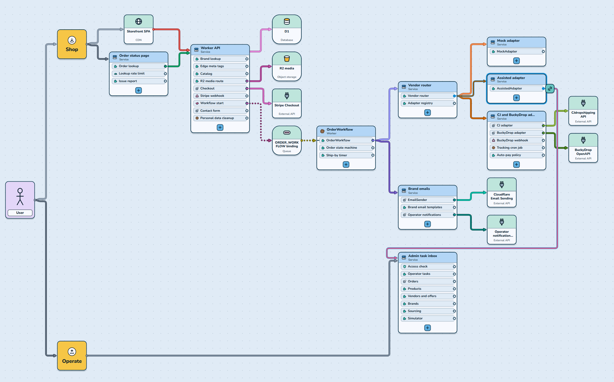
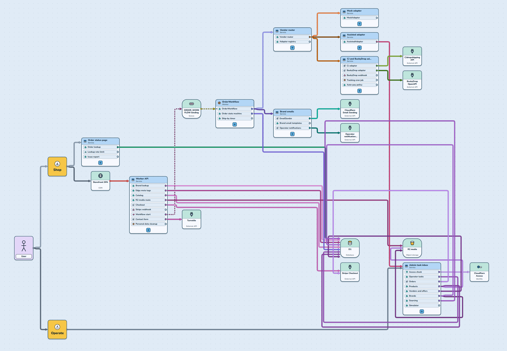

# dropshipping

Have a non-SWE friend who wants to trial doing something like the above diagram, so I am helping with the software side of things. 

Besides having a website for listing products and placing orders, it would be ideal to have the UI support different skins so that multiple "brands" could be created pretty easily, since consumer interests are sensitive to change with trends.

## Jeeves Diagram

### v1

I had Fable 5.2 take a look at the diagram. It addressed the 'too many arrows' thing on its own.

- The original build plan left out user accounts on purpose
- MockAdapter is to help validate real orders
- D1 can't do transactions or joins across databases. 
  - I think in this use case, having 1 database is fine since we aren't anticipating a ton of traffic here - a few hundred sales would be way more than expected at this point.

So far so good then!

### v0

There are some immediate concerns with Opux 5.5 xhigh's first pass.

- Too many connections out of the Worker API and Admin Task Inbox API microservices. 
- Lots of dumping data across different lanes into 1 D1 tile.
- No user accounts supported
- MockAdapter seems test-related
- I need to look into what CJ and BuckyDrop do. Not sure.

